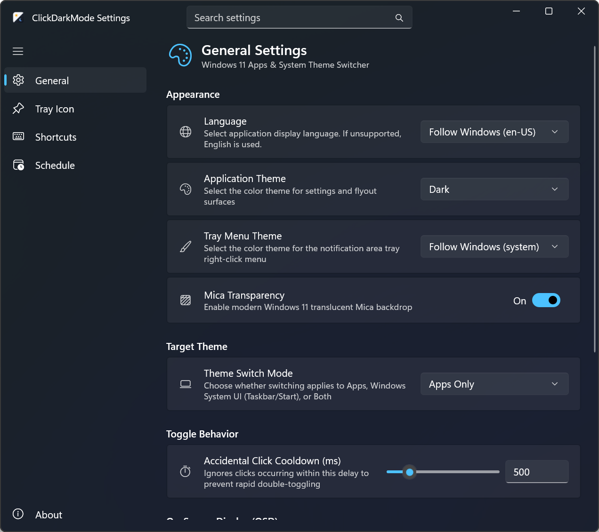
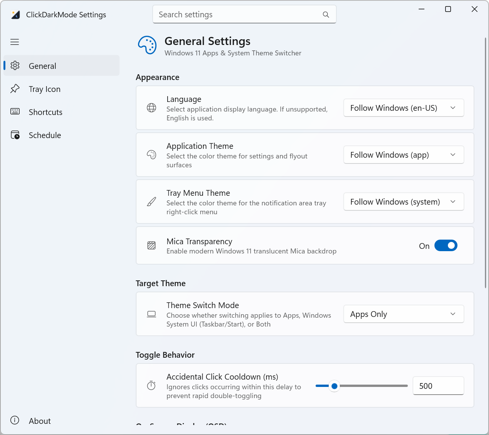
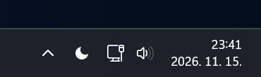
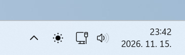
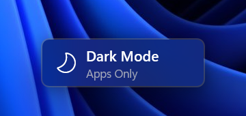
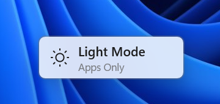

# ClickDarkMode

<p align="center">
  <br/>
  <strong>Lightweight, modern Windows 11 system tray dark and light mode switcher utility</strong><br/><br/>
  
  
  
  
  
</p>

> **Note:** This is a vibecoded application (built and refined with AI assistance).

<p align="center">
  <a href="#overview">Overview</a> •
  <a href="#screenshots">Screenshots</a> •
  <a href="#features">Features</a> •
  <a href="#building-from-source">Building</a> •
  <a href="#packaging--distribution">Packaging</a> •
  <a href="#license">License</a>
</p>

---

## Overview

**ClickDarkMode** is a native, ultra-lightweight Windows 11 system tray utility designed to effortlessly switch between **Dark and Light mode** for Applications and the Windows System UI (Taskbar, Start Menu, Shell).

Built with **C++20 / C++/WinRT** and **WinUI 3** (Windows App SDK), it features a modern Windows 11 Fluent Settings interface with Mica backdrops, custom tray icons, global keyboard shortcuts, On-Screen Display (OSD) notification banners, automated scheduling (Custom Times & offline NOAA Solar Sunrise/Sunset calculation).

---

## Screenshots

### Settings Window
*Fluent WinUI 3 configuration interface with Mica backdrop, instant search, custom tray icons, hotkey assignment, and offline solar scheduling.*

| Dark Mode | Light Mode |
| :---: | :---: |
|  |  |

### System Tray
*Direct taskbar switching with mode-adaptive tray icons and native WinUI 3 flyout menu.*

| Dark Mode | Light Mode |
| :---: | :---: |
|  |  |

### On-Screen Display (OSD)
*Modern Windows 11 floating banner with smooth animations for real-time mode transitions.*

| Dark Mode | Light Mode |
| :---: | :---: |
|  |  |

---

## Features

### 1. Fluent WinUI 3 Settings (ClickBrightness Design)
- Modern Windows 11 Mica backdrop (`transparencyEnabled`) with automatic dark/light mode adaptation and solid color fallbacks.
- Custom draggable title bar with embedded application icon, title, and interactive instant search box (`SettingsSearchBox`).
- Left-side Fluent `NavigationView` organized into 5 intuitive pages:
  - **General:** Language selection, Application Color Mode (Follow Windows, Dark, Light), Tray Menu Mode, Mica transparency toggle, Mode Switch Target (Both, Apps Only, Windows Only), double-click cooldown delay, OSD banner hide time (Slider + NumberBox, default 2000 ms), Start with Windows toggle (with smart Program Files detection), and factory reset.
  - **Tray Icon:** Tray Icon Mode ComboBox (Follow Windows [System] by default, Custom, Disabled [Use Program Icon]), Separate Light & Dark icon mode toggle (supported in both Follow Windows and Custom modes), Show OSD banner on tray click (enabled by default), Custom Light icon picker & preset ComboBox (Sun [Default], Sun White, Sun Dark, Star, Monitor), Custom Dark icon picker & preset ComboBox (Moon [Default], Moon White, Moon Dark, Monitor Dark).
  - **Shortcuts:** Global keyboard shortcut toggle, interactive key combination capture button, Show OSD banner on hotkey toggle, and quick preset buttons (`Ctrl + Alt + T`, `Win + Shift + D`, `Win + Alt + T`, `Ctrl + Shift + T`).
  - **Schedule:** Automated dark/light mode transitions with 3 modes:
    - *Disabled (Manual only)*
    - *Custom Time Schedule:* Independent 24-hour TimePickers for Light Mode Start Time and Dark Mode Start Time.
    - *Sunrise / Sunset Sync:* Calculates local solar sunrise and sunset times based on coordinates with 100% offline NOAA astronomical zenith mathematics. Includes one-click Auto-Detect via Windows Location API, global city preset ComboBox (30 major world cities), and live today's solar preview.
    - *Show OSD On Scheduled Switch:* Automatically hidden when scheduling is disabled.
  - **About:** Version info, application description, technology stack details, and license.

### 2. Modern On-Screen Display (OSD)
- Displays a sleek, non-intrusive floating Fluent banner overlay confirming mode transitions (Dark/Light).
- Indication reflects the new mode and includes a matching icon.
- Configurable auto-hide timeout (500 ms to 5000 ms, default 2000 ms).
- Independent visibility toggles for Tray Click, Global Hotkey, and Scheduled switches.

### 3. Native WinUI 3 Tray Menu
- Uses a borderless 1×1 topmost anchor window to display a native WinUI 3 `MenuFlyout` positioned above the taskbar icon.
- Left-click directly toggles between Dark and Light mode (guarded by an accidental double-click cooldown).
- Right-click opens the menu:
  - **Toggle Mode** (🖌️)
  - Separator
  - **Settings...** (⚙️)
  - Separator
  - **ClickDarkMode v1.0.0** (ℹ️)
  - **Exit** (⏻)

### 4. Multi-Architecture Support (x64 & ARM64)
- Native 64-bit Intel/AMD (`x64`) build.
- Native 64-bit ARM (`ARM64`) build optimized for Qualcomm Snapdragon X Elite, Microsoft Surface Pro, and Windows on ARM devices.

### 5. Full Multilingual Localization
- Built-in dynamic localization supporting English (`en-US`) and Hungarian (`hu-HU`).
- Switchable on the fly without restarting the application.

### 6. Portable Mode & Safe Autorun
- When running from a portable folder (or when `portable.txt` is present), settings (`settings.ini`) are stored directly in the application folder rather than in `%LocalAppData%`.
- Automatically prevents broken autorun registry entries when running portably; *Start with Windows* is safely enabled when installed in `Program Files`.

---

## Building from Source

### Prerequisites
- Windows 10 (1809+) or Windows 11
- Visual Studio 2022 (or higher) with the following workloads:
  - **Desktop development with C++**
  - **C++ (v143 / v145) Universal Windows Platform tools**
  - **Windows 11 SDK** (10.0.26100.0 or higher)
  - **MSVC v143/v145 - VS 2022 C++ ARM64 build tools** (optional, for ARM64 builds)
- Optional: WiX Toolset v5 (if creating MSI installers)

---

### Option A: Building with Visual Studio (Recommended)

1. Open `ClickDarkMode.sln` in **Visual Studio 2022**.
2. Select your desired build configuration and platform:
   - **Configuration:** `Release` (or `Debug`)
   - **Platform:** `x64` or `ARM64`
3. Visual Studio will automatically restore the required NuGet packages (defined in `packages.config`). If not, right-click the solution in Solution Explorer and select **Restore NuGet Packages**.
4. Press `Ctrl + Shift + B` (or select **Build > Build Solution**).

The compiled binary will be placed in:
- **x64:** `bin\x64\Release\ClickDarkMode.exe`
- **ARM64:** `bin\ARM64\Release\ClickDarkMode.exe`

---

### Option B: Building via Command Line (MSBuild)

Open **Developer Command Prompt for VS 2022** or **Developer PowerShell**, navigate to the project directory, and run:

1. **Restore NuGet packages:**
   ```cmd
   nuget restore ClickDarkMode.sln
   ```

2. **Compile the project:**
   - **For 64-bit Intel/AMD (x64):**
     ```cmd
     msbuild ClickDarkMode.sln /p:Configuration=Release /p:Platform=x64
     ```
   - **For 64-bit ARM (ARM64):**
     ```cmd
     msbuild ClickDarkMode.sln /p:Configuration=Release /p:Platform=ARM64
     ```
   - **Clean rebuild:**
     Add `/t:Rebuild` to any of the commands above.

---

### Post-Build Setup (Running Standalone / Portable)

When running the application directly from the build output directory (`bin\x64\Release\` or `bin\ARM64\Release\`), ensure the required language and resource files are present:

```cmd
:: Copy localization files and resources
xcopy /y /e /i lang bin\x64\Release\lang\
if not exist bin\x64\Release\resources mkdir bin\x64\Release\resources
xcopy /y /e /i resources bin\x64\Release\resources\
copy /y resources\*.ico bin\x64\Release\
copy /y bin\x64\Release\ClickDarkMode.pri bin\x64\Release\resources.pri
```

To enable **Portable Mode** (storing settings in the application folder instead of `%LocalAppData%`), create an empty `portable.txt` in the binary directory:
```cmd
type nul > bin\x64\Release\portable.txt
```

---

## Packaging & Distribution

### 1. Portable ZIP Package (PowerShell)
You can create a standalone distribution ZIP using PowerShell:
```powershell
Compress-Archive -Path bin\x64\Release\* -DestinationPath bin\ClickDarkMode-1.0.0-x64-portable.zip
```
*(Ensure `lang\`, `.ico` files, and `portable.txt` are included alongside the executable and runtime libraries).*

### 2. MSI Installer (WiX Toolset v5)
To package an installer using WiX v5:

1. **Install WiX Toolset and extensions:**
   ```cmd
   dotnet tool install --global wix --version 5.0.2
   wix extension add WixToolset.UI.wixext/5.0.2 -g
   wix extension add WixToolset.Util.wixext/5.0.2 -g
   ```

2. **Build the MSI installer:**
   - **x64:**
     ```cmd
     wix build installer\Package.wxs -arch x64 -ext WixToolset.UI.wixext -ext WixToolset.Util.wixext -o bin\ClickDarkMode-1.0.0-x64.msi
     ```
   - **ARM64:**
     ```cmd
     wix build installer\Package.wxs -arch arm64 -ext WixToolset.UI.wixext -ext WixToolset.Util.wixext -o bin\ClickDarkMode-1.0.0-arm64.msi
     ```

The installer features per-machine installation into `C:\Program Files\ClickDarkMode`, Start Menu and optional Desktop shortcuts, and running-process detection.

---

## License

This project is licensed under the [MIT License](LICENSE).
